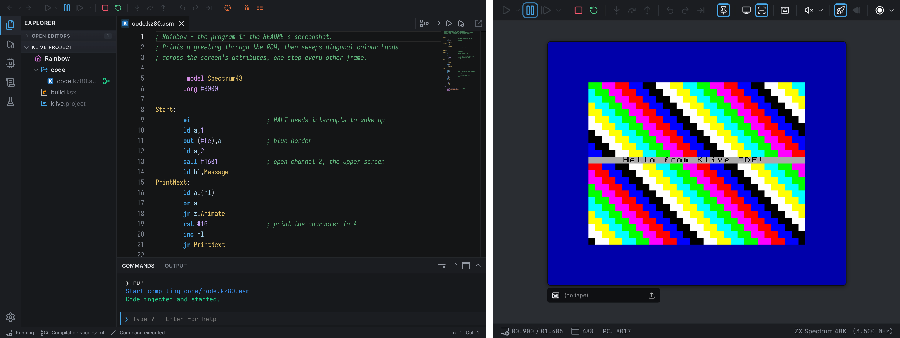

<div align="center">


# Klive IDE

### A retro computer emulator and IDE for Z80 lovers — on Mac, Windows, and Linux

[](https://github.com/Dotneteer/kliveide/releases)
[](LICENSE)
[](https://kliveide.net/)
[](#-community--contributing)

**[Documentation](https://kliveide.net/)** · **[Download](https://github.com/Dotneteer/kliveide/releases)** · **[Get Started](https://kliveide.net/en/get-started/)** · **[Discussions](https://github.com/Dotneteer/kliveide/discussions)**

</div>

---

Klive IDE is a cross-platform emulator and integrated development environment for Z80-based retro
computers, built by retro-computing enthusiasts for retro-computing enthusiasts. Write Z80 assembly or
BASIC, press one button, and watch your code run — or step through it — inside the emulated machine.



## ✨ At a Glance

- **Machines** — ZX Spectrum 48K/128K/+2A/+3/+2E/+3E, ZX Spectrum Next, Timex TC2048/TC2068/TS2068,
  Pentagon, Scorpion ZS-256, Cambridge Z88, Sinclair ZX80/ZX81, and HT-1080Z.
  [All machines and models →](https://kliveide.net/en/reference/machine-types/)
- **Languages** — the built-in Klive Z80 Assembler and Klive BASIC, plus Boriel BASIC, SJASMPLUS,
  z88dk, and PASTA/80. [Languages →](https://kliveide.net/en/guides/languages/klive-z80-assembler/)
- **One-click workflow** — compile, inject, run, or debug your program in the emulator from the editor.
- **Debugger** — breakpoints with conditions, watches, memory and disassembly views, call stack,
  execution history, and reverse debugging. [Debugging →](https://kliveide.net/en/guides/debugging/run-debug/)
- **Media** — tapes, disks, snapshots, Microdrives, SD cards, and screen recording to video.

## 🚀 Getting Started

Download the installer for macOS, Windows, or Linux from
[GitHub Releases](https://github.com/Dotneteer/kliveide/releases), then follow
[Get Started](https://kliveide.net/en/get-started/) on the documentation site.

To build Klive from source, see
[Get the Source Code](https://kliveide.net/en/under-the-hood/contribute/get-source/). In short:

```bash
git clone https://github.com/Dotneteer/kliveide.git
cd kliveide
npm install
npm run build:all-wasm   # required on every fresh clone
npm run dev
```

`build:all-wasm` compiles the emulator cores (C → WebAssembly). It needs `clang` with the `wasm32`
target and `wasm-ld`; see [Install the WASM toolchain](https://kliveide.net/en/under-the-hood/contribute/wasm-toolchain/).

## 🤝 Community & Contributing

This project is a **passion project**, born from a love of retro computing. My first computer was a ZX81, followed by a ZX Spectrum 48K. Klive is my way of honoring that legacy—not for profit, but for the joy of creation and connection with fellow enthusiasts.

Whether you want to fix a typo, improve documentation, squash a bug, add a new machine, or propose a new feature—**every contribution is welcome and appreciated**.

The IDE is written in TypeScript (Electron + React), and the emulator cores in C compiled to WebAssembly. The documentation site explains how to [get the source](https://kliveide.net/en/under-the-hood/contribute/get-source/), [improve the docs](https://kliveide.net/en/under-the-hood/contribute/improve-docs/), and [translate Klive](https://kliveide.net/en/under-the-hood/contribute/translate/).

**Feel free to reach out:** dotneteer@hotmail.com

### Contributors

A heartfelt thank-you to these amazing people:

| Contributor                                                                   | Contribution                                                       |
| ----------------------------------------------------------------------------- | ------------------------------------------------------------------ |
| [bits4fun](https://github.com/bits4fun)                                       | Inspired the project; helped bring Cambridge Z88 emulation to life |
| [vrishe](https://github.com/vrishe)                                           | New IDE features and bug-squashing wizardry                        |
| [TheStruggleForAntiSpaghetti](https://github.com/TheStruggleForAntiSpaghetti) | Thoughtful suggestions, testing, and stability improvements        |
| [Pete-L-72](https://github.com/Pete-L-72)                                     | Testing and helping shape a more stable IDE                        |

---

<div align="center">

Made with ❤️ for the retro-computing community

[Documentation](https://kliveide.net/) · [Releases](https://github.com/Dotneteer/kliveide/releases) · [Issues](https://github.com/Dotneteer/kliveide/issues) · [Discussions](https://github.com/Dotneteer/kliveide/discussions)

</div>
