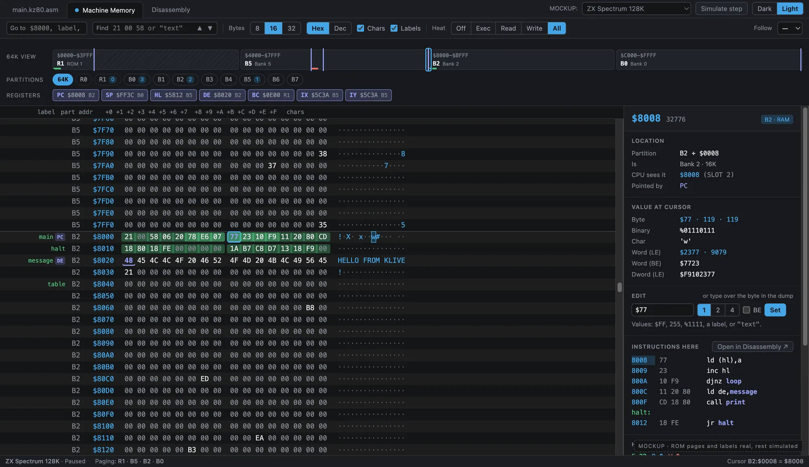
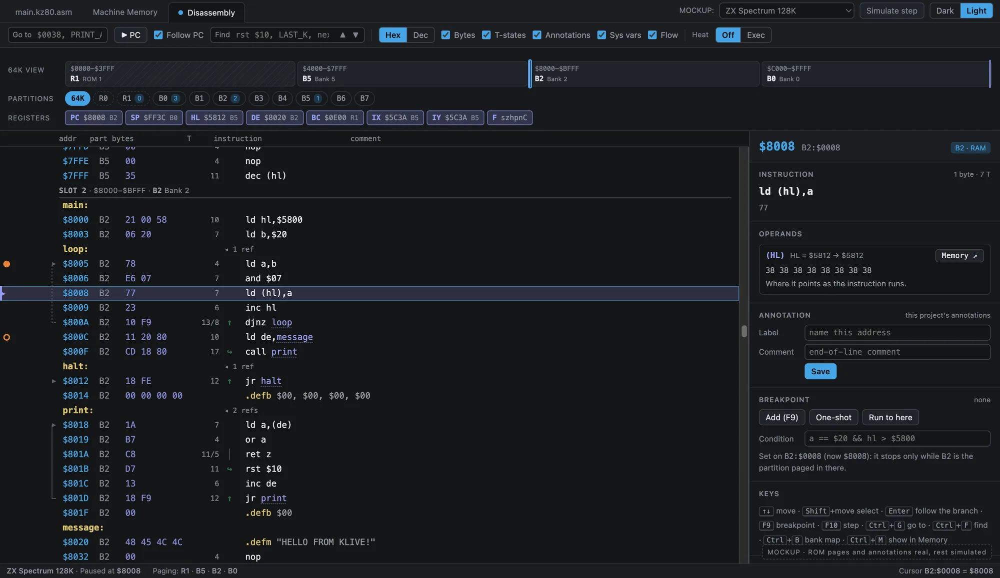
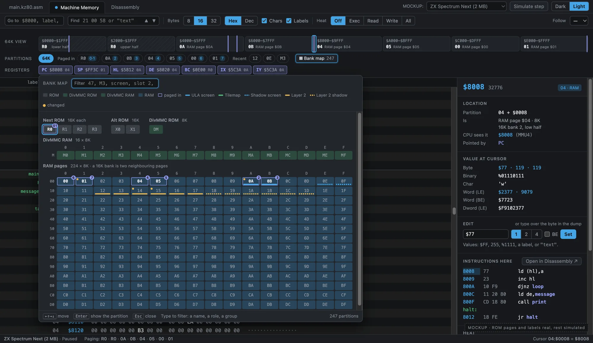
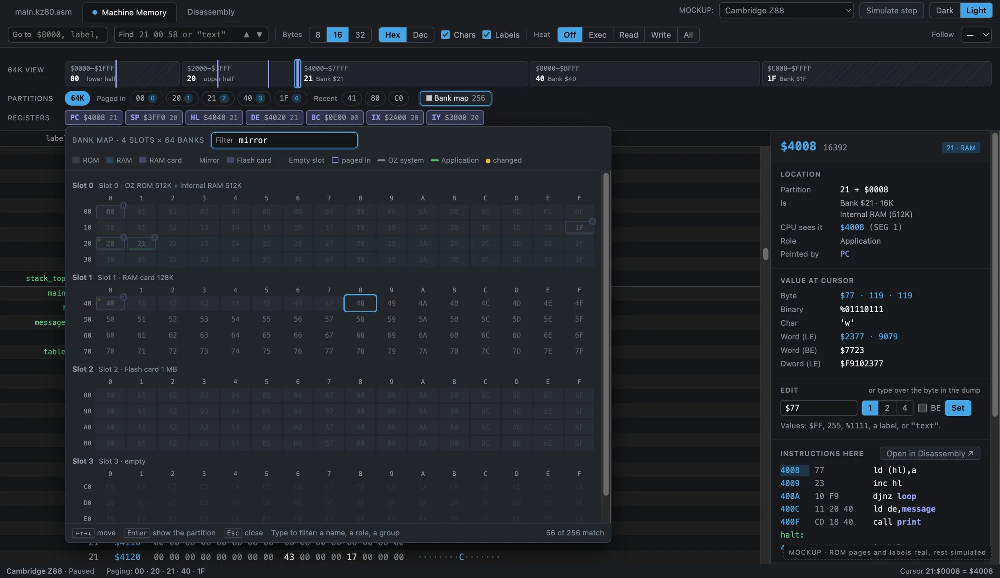
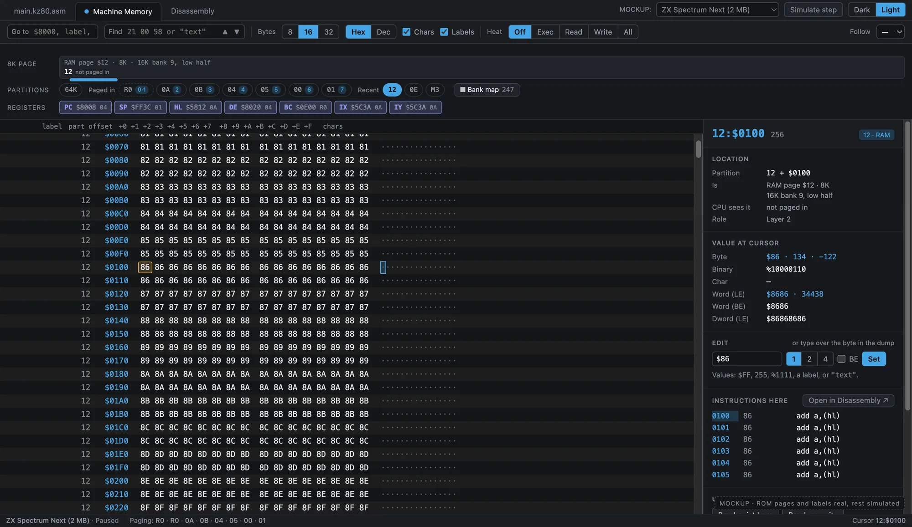
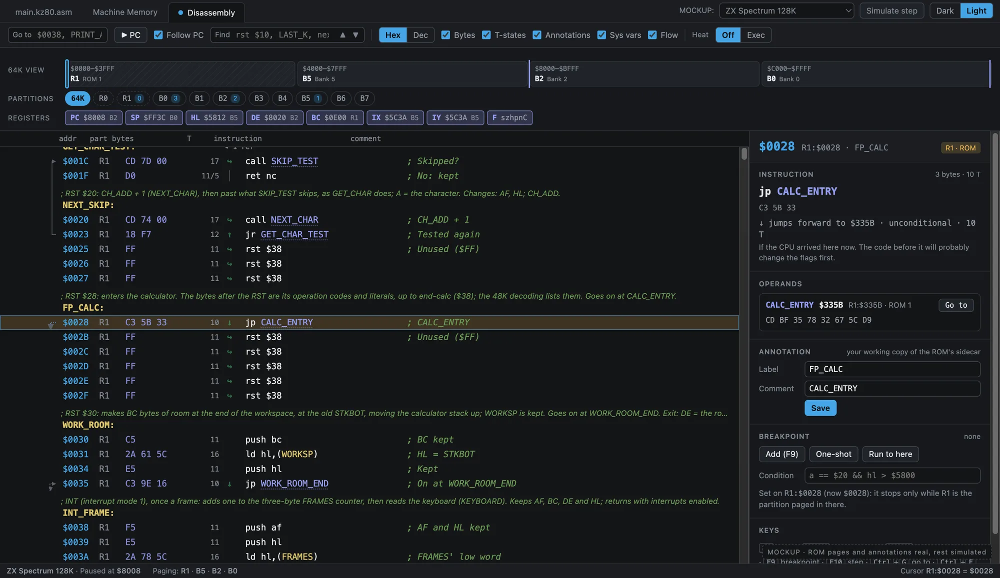
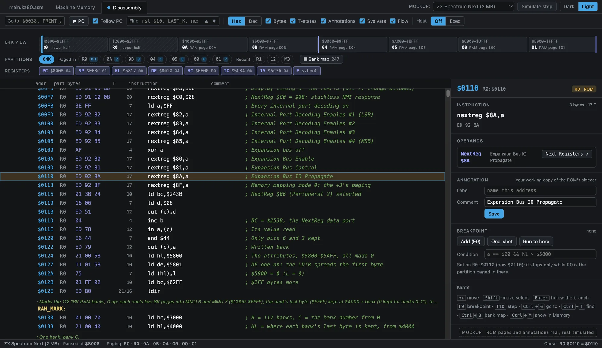
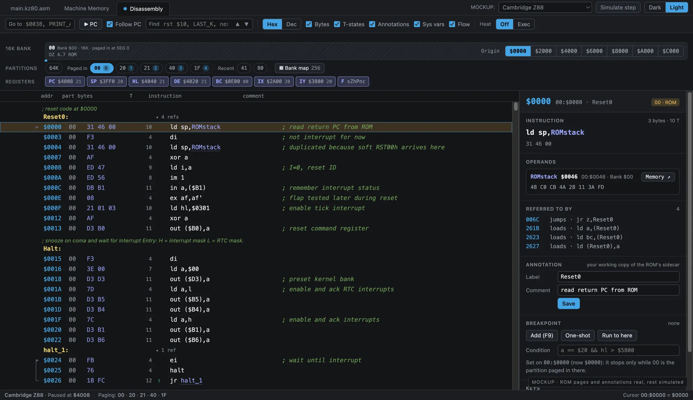

# Memory And Disassembly Views Modernization Plan

Status: **proposed** (2026-11-18, branch `feature/memory-view-mockup`). Nothing is built yet.

Mockups (open in a browser, or serve the folder with the `mockups` entry of `.claude/launch.json`):

- `dev/plans/memory-disassembly-views/memory/mockup.html` — the Memory view
- `dev/plans/memory-disassembly-views/disassembly/mockup.html` — the Disassembly view

Each has a **Machine** menu (mockup only): ZX Spectrum 128K, Cambridge Z88, ZX Spectrum Next (2 MB)
and Next KS3 (4 MB). The ROM pages, their labels, data regions, comments and synopses are real (Klive's
own sidecars), and so are the system variable and NextReg names. RAM, paging, registers, the user's
program and labels, coverage and breakpoints are simulated. Rebuild them with
`node dev/plans/memory-disassembly-views/{memory,disassembly}/build-mockup.cjs`; the code they share is
in `memory-disassembly-views/shared/` (`machines.js`, `z80.js`, `view.css`, `build-lib.cjs`).
**The mockups' code is a sketch, never a source to copy**: the IDE's own disassembler, resolver and
annotation model are what the views are built on (§6).

## 1. Goal

Make the Memory and the Disassembly views two faces of one tool. They share one frame — a toolbar of
segmented controls, a **memory map bar**, a **partition row** that scales to the Z88's 256 banks and
the Next's 247 (503) partitions, a register strip and an **inspector column** — and each puts its own
listing in the middle: a hex dump, or an annotated instruction listing.

The work closes the gaps found in today's views:

| Today | After |
|---|---|
| Registers that point at a byte are named only in the hover tooltip | Inline register tags in the dump; register chips that jump; **Follow** a register |
| Changed bytes are not marked in the machine's Memory view | The shared "changed since the previous stop" dot |
| One bank at a time: a **64K View** switch and a chooser of up to 247 entries | A map bar of the paging, paged-in and recent chips, and a **Bank map** of every partition |
| Editing a byte opens a modal dialog | Type over the byte, or edit it in the inspector |
| No find, no range selection | Find bytes, text or labels; select a range and act on it |
| Go To takes a number | Go To takes a number, a label, a register or a partition-qualified address (`47:$0100`) |
| Disassembly: jumps are verdict glyphs only | A **flow gutter** of arrows between jumps and their targets |
| Disassembly: details live in tooltips, dialogs and menus | An inspector for the selected instruction: verdict, operands and what they point at, references, annotation, breakpoint |

## 2. The mockups

| | |
|---|---|
|  |  |
| Memory, 128K: map bar, all ten partitions as chips, register tags in the gutter, heat on | Disassembly, 128K: flow gutter, verdicts, breakpoint shapes, label rows with reference counts |
|  |  |
| Next: the Bank map of 247 partitions; paged-in badges and role bars | Z88: four card slots of 64 banks, filtered to "mirror" |
|  |  |
| One 8K page shown by offset, with its role and "not paged in" | The ROM's synopses, comments and data regions from its sidecar; system variable operands |
|  |  |
| Next: Z80N `nextreg` rows commented with the register's name | Z88: OZ bank `$00` disassembled at an **Origin**, with its references |

## 3. What exists (the base this builds on)

**Memory view** (`src/renderer/features/memory/`): `MemoryPanel.tsx` (virtualised rows,
`VirtualizedList`), `MemoryToolbar.tsx` / `MemoryBankToolbar.tsx` (Decimal, View 8B/16B layouts,
Chars, Bank, Heat, Go To, Show as graphics; 64K View and the partition chooser, `PartitionPicker` /
`BankDropdown`), `MemoryDumpSection.tsx` (one text node per row with `ch`-positioned overlays: hover,
last jump, heat cells, changed-byte marks), `useMemoryRefresh.ts` (`emuApi.getMemoryContents(partition)`
→ `MemoryInfo`: bytes, registers, `partitionLabels`, `slotPartitions`, `memBreakpoints`),
`useMemoryMachineSetup.ts` (partition labels, descriptions, groups, ROM flags), `memoryViewModel.ts`
(`buildPointedRegisterHints`, view modes), `useMemoryViewState.ts`, `memoryPerformance.ts`, the
`SetMemoryDialog`, the heat map (`features/coverage/heatModel.ts`, `memory-heat` command) and the
navigation adapter (`appIde/navigation/addressNavigationAdapters.ts`).

**Disassembly view** (`src/renderer/appIde/DocumentPanels/`): `DisassemblyPanel.tsx`,
`DisassemblyRow.tsx`, `DisassemblyToolbars.tsx`, `disassemblyViewState.ts`, `disassemblyRowMenu.ts`,
`branchVerdict.ts` (verdicts and the PC readout), `breakpointRowMatch.ts`; the machines' disassemblers
(`appIde/disassemblers/z80-disassembler/`, `z80-branch-info.ts`, ROM-gated custom decoders); the
annotation stack (`appIde/annotations/`: `liveAnnotatedDisassembly.ts`, `symbolResolver.ts`,
`useAddressSymbols.ts`, `romAnnotations.ts`, `liveAnnotationEditing.ts`, `labelReferences.ts`,
`goToDefinition.ts`), system variable operands (`useSysVarOperandLabels.ts`), Export as source and the
reverse-engineering menu. Read `dev/patterns/annotations.md` ("The Shared Resolver", "The Live
Disassembly View", "Interactive Editing") and `dev/patterns/reverse-engineering-tools.md` first.

**Popped-out dumps** (`features/memory/StaticMemoryDump.tsx`: a NEX bank, a tape block, a Z88 or
Spectrum bank document) render through the same `MemoryDumpSection` and their own disassembly mode.
They keep their layout in this plan; the dump marks they share (changed dots, register tags where a
bank is paged in, type-over) come to them through `MemoryDumpSection`, and phase 3 checks them.

**Partitions and paging**: `@common/annotations/bankSpace` and `useMachineBankSpace.ts`; per machine
`getPartitionLabels/Descriptions/Groups` (`z88MachineInfo.ts`, `nextMachineInfo.ts`, the 128K family);
partition-qualified breakpoints (`bp-set r1:$32ac`, `BreakpointInfo.partition`, `length` for ranges).

## 4. The shared frame

### 4.1 Toolbar

One strip of segmented controls and switches, `PanelHeader` + `PanelHeaderGroup`, folding low-priority
groups into `⋯` as the document narrows ("A Document Lays Itself Out By Its Own Width" and "A Toolbar
Of Fixed-Size Controls Wraps; It Never Shrinks" in `dev/ai/ui-theming-intent-and-lessons.md`).

- **Go to**: a number (hex unless Decimal), `$`/`0x`/`%` forms, a label (the resolver's: build,
  active set, ROM, system variables), a register name, or `PART:offset`. Partition-qualified addresses
  use the breakpoint syntax and parser (`parsePartitionLabel`), so a `bp-set` address and a Go to
  address are one language.
- **Find**: see §5.3 and §6.3. Count `n / m`, F3 / Shift+F3.
- Number format, view options (per view, §5–6) and **Heat** as segmented controls.
- **Follow**: Memory follows a register (PC, SP, HL, …); Disassembly keeps **Follow PC**, plus a
  **▶ PC** button (today's "Go to the PC address").

### 4.2 Memory map bar

A strip of the address space as the CPU sees it now: one cell per paging unit (four 16K slots, the
Next's eight MMU slots, the Z88's segment 0 halves and SR1-SR3), each with its address range, the
partition in it and its name; ROM hatched, an empty slot dashed. A frame shows the part in view; ticks
mark PC and SP; with Heat on, a strip under each cell summarises it. Clicking a cell goes to its start.
With one partition shown, the bar is that partition (name, size, where it is paged in or "not paged
in", role) and the viewport is a strip along its bottom edge.

### 4.3 Partition row and Bank map

- **Up to 16 partitions** (48K: none; 128K: 10; +3E: 12): every partition as a chip, plus **64K**.
- **More** (Z88 256, Next 247 or 503): **64K**, then **Paged in** (with the slot numbers as a badge:
  `R0 0·1`, `0A 2`), then **Recent** (the last partitions opened, per document), then **Bank map** with
  the count. Ctrl+B opens the map.
- **The Bank map** is a popover grid of every partition, laid out by the machine (§7): the Next's ROM,
  Alt ROM and DivMMC ROM as chips, DivMMC RAM as a row, RAM pages 14×16 (and Upper RAM 16×16 on a 4 MB
  board); the Z88's four card slots as 4×16 grids headed by what is in the slot. Each cell: the
  partition's id, its **kind** (ROM, RAM, card RAM, flash, DivMMC, empty, mirror), a **paged-in badge**
  with its slot, a **role bar** (ULA screen, shadow screen, Layer 2, Layer 2 shadow, tilemap), a
  **changed** dot and, in the Disassembly view, an **annotated** dot. A filter matches id, name,
  group, role, kind and slot; non-matching cells fade but keep their place. Arrows move, Enter opens,
  Esc closes. The partition names are the machine's own (`partitionLabels`), never invented.
- Showing a partition on its own shows it by **offset** in the Memory view, and at an **Origin** in the
  Disassembly view (today's Offset chooser: 8K boundaries; default where it is paged in).

### 4.4 Register strip

Chips for the registers that hold addresses (PC, SP, HL, DE, BC, IX, IY; the alternate set and IR/WZ
behind a `⋯` as `buildPointedRegisterHints` lists them), each with its value and the partition it
points into; click to go there. The Disassembly view adds the **F** flags chip (`SZ5H3PNC`), since the
verdicts are judged against it.

### 4.5 Inspector column

A `46ch` column (stacking under the listing below `120ch` of the document's width), sections as in "A
File And Its Parts: An Inspector Column Beside The List": a header with the address, `PART:offset` and
a kind badge, then the view's sections (§5.2, §6.2), each in its own `ScrollViewer`. A toggle hides it
(per document); a hidden inspector leaves the listing the full width, as today.

### 4.6 Colour

The Memory dump and the Disassembly listing keep their settled exceptions to the neutral data
hierarchy (addresses in the accent, the secondary accent for the second kind of number). New marks
reuse existing roles: register tags in `--color-state-value-alt` (they are the row's second kind of
value), changed dots in `--color-state-changed`, the Next's role bars in the layer identity hues of
the Layers views (ULA `--status-info`, tilemap `--status-success`, Layer 2 `--status-warning`), labels
in the disassembly label tokens, ROM labels set back as today (`--color-disassembly-rom-label`).
New tokens are L4 aliases (`--color-memmap-*`, `--color-flow-*`), never literals; the mockups' hex
values are placeholders.

## 5. The Memory view

### 5.1 The dump

- Rows of 8, 16 or 32 bytes (`viewMode` gains `32x1`; the persisted `8x2` stays readable), Hex/Dec,
  Chars.
- A **label gutter** (`16ch`, optional): the first label of the row (resolver), and **register tags**
  for the registers pointing into it; the byte itself is underlined in the register hue.
- **Changed since the previous stop**: the shared dot, from a baseline taken like the Sprite
  Inspector's (`useNextSpriteState`): the stop before this one while paused, the last stop while running.
- **Memory breakpoints**: a range read/write breakpoint (`memBreakpoints`, `length`) marks its bytes.
- A **slot boundary** row rule where the 64K view crosses into another slot.
- Heat as today.

### 5.2 Inspector sections

**Location** (partition and offset, the partition's description, where the CPU sees it, role, label
with its synopsis, the registers pointing here, changed); **Value at cursor** (byte unsigned/signed,
binary, character, word LE/BE with a label for the word, dword); **Edit** (value, size 1/2/4, BE; the
reason when the byte cannot be written: ROM, flash, empty slot); **Selection** (range, length,
sum/XOR, as text; Copy hex, Copy as `.defb`, Show as graphics, Find these bytes); **Instructions here**
(a few rows from the machine's disassembler, Open in Disassembly); **Heat** (E/R/W counts);
**Use** (Breakpoint here, Break on write — a range breakpoint for a selection —, Watch as word).

### 5.3 Editing, selection, find

- **Type over**: hex digits (decimal digits in Decimal) overwrite the byte under the cursor and move on;
  Enter commits a partial value, Esc cancels. The writes go through the path `SetMemoryDialog` uses
  today, so the history rule holds (in the past, an edit asks to take over first). The dialog stays for
  multi-byte values from the context menu.
- **Selection**: Shift+arrows, Shift+click, drag. The selection is one range per view.
- **Find**: a byte pattern (`21 00 58`, `21 ?? 58`), quoted text, or a label. Over the view (64K or the
  partition shown); "All partitions" searches the machine's whole memory through a new
  `emuApi.findMemory(pattern, scope)` so 2 MB is not copied to the renderer.

## 6. The Disassembly view

### 6.1 The listing

- **Unchanged behaviour**: everything in "The Disassembly View" guide and `dev/patterns/annotations.md`
  (live annotated listing, ROM labels toggle, Sys vars, Follow PC, custom ROM decoders, branch
  verdicts and the PC readout, breakpoint gutter gestures, row menu, Go to Definition/References, Export).
- **Paging separators**: a rule row where the 64K listing enters another slot, naming slot, range and
  partition (the mockups' `SLOT 2 · $8000–$BFFF · B2 Bank 2`).
- **Label rows** carry a **reference count** (`◂ 3 refs`), counted by
  `countLabelReferencesInListing` — the rule "Go to References" and the Labels list use — and open the
  references in the inspector.
- **Flow gutter**: an SVG lane gutter between the breakpoint gutter and the address. Arrows for `JR`,
  `JP`, `DJNZ` (not `CALL`/`RST`, which keep the verdict hook) whose source and target are both in the
  listing, laid out in up to eight lanes, shortest innermost; dashed when conditional; the taken branch
  at the PC drawn in the verdict hue; both ends of the selected row's jumps highlighted. A jump longer
  than about a screen of rows (48) gets a **stub at each end** instead of a line across the listing; a
  target outside the listing gets a stub pointing up or down. Off with the **Flow** switch. The edges
  come from `z80-branch-info.ts`, computed once per listing with the lanes.
- An empty Z88 slot is one row (`— Slot 3 is empty —`), not 16K of `rst $38`.

### 6.2 Inspector sections

**Instruction** (the row as printed, bytes, length, T-states taken/not); **Verdict** (as the PC
readout, marked certain at PC and "if the CPU arrived here now" elsewhere); **Operands** (each address
operand: its name, value, `PART:offset`, partition, the first bytes there, Go to / Memory ↗; a system
variable's description; a NextReg's name and a link to the Next Registers document; `(HL)`, `(IX+d)`
resolved to an address and its bytes); **Referred to by** (`labelReferences.ts`, listing rows with
their printed text, clickable); **Annotation** (label and end-of-line comment edited in place through
`liveAnnotationEditing.ts`: committed on Enter or leaving the field, **no Save button** — "Interactive
Editing" in `dev/patterns/annotations.md`; RAM rows to the active set, ROM rows to the user's ROM layer,
the reason when a row is not annotatable); **Breakpoint** (state; Add/Remove, One-shot, Run to here;
a Condition field in the Breakpoint dialog's language, `useBreakpointDialog` for the rest);
**Selection** (Copy as source — through the export path, not the mockup's text join —, Export…, Show
in Memory).

### 6.3 Find

Over the listing's printed text: mnemonics and operands as printed (names included), labels and
comments. Results are rows; the count and F3 as in the Memory view.

## 7. Machine data the views need

The partition model grows from labels/descriptions/groups to a `PartitionInfo` the bank map, the chips
and the inspector read (`src/common/annotations/` beside `bankSpace`, one provider per machine family):

| Field | Meaning | Source |
|---|---|---|
| `id`, `name`, `group` | As today (`getPartitionLabels/Descriptions/Groups`) | machine info |
| `kind` | `rom`, `ram`, `cardRam`, `flash`, `eprom`, `divRom`, `divRam`, `empty`, `mirror` | machine info + configuration |
| `size` | 8K or 16K | machine info |
| `mirrorOf` | The partition a mirror repeats | Z88: the card size (`z88ChipMaskForSize`) |
| `note` | "OZ 4.7 ROM", "RAM card, 128K", "Slot 3 is empty" | Z88: `emulatorState.config` `MC_Z88_SLOT0..3`, `MC_Z88_INTRAM/INTROM` |
| `roles` | `ulaScreen`, `shadowScreen`, `layer2`, `layer2Shadow`, `tilemap` | Next: NextRegs `$12`, `$13`, `$6E`/`$6F`, `$69`, port `$7FFD` (state, refreshed with the machine); 128K: banks 5 and 7 |
| `bank16` | "16K bank 9, low half" | Next pages |
| `layout` | How the bank map lays the partitions out (chip groups, grid of 16) | machine info |

Today the Z88 describes every bank as "RAM Banks"; the slots' cards are known to the emulator and the
configuration, so the provider describes what is really there. Roles are recomputed on each refresh
and never stored. A machine without partitions (48K, ZX81) shows the 64K bar and no partition row.

## 8. Phases

Each phase ends green on the focused tests, `npm run build:check`, `npm run lint:renderer` and
`npm run i18n:check`; UI phases also on a doc-shot recipe run (§9) and a look in the running IDE.

1. **Partition model.** `PartitionInfo` and the providers for the Spectrum family, Z88 (cards,
   mirrors, empty slots) and Next (2 MB, KS3 Upper RAM, roles). Pure; unit tests per machine
   (the Z88 with each card size and an empty slot; a Next whose `$12` moves Layer 2).
2. **Shared frame components** in `src/renderer/features/memoryMap/`: `MemoryMapBar`,
   `PartitionRow` (chips, Paged in, Recent), `BankMapPopover` (grid, filter, keyboard), `RegisterStrip`,
   the inspector column shell, the Go to target parser (number, label, register, `PART:offset`) shared
   with the commands. jsdom tests for the popover's keyboard and filter, the parser, the recent list.
   Tokens (L4 aliases), i18n keys with translator context, `ch` widths, rows from `rowSizes.ts`.
3. **Memory view.** Adopt the frame; label gutter and register tags; changed baseline; memory
   breakpoint marks; 32-byte rows; inspector; type-over editing and selection; Follow; Find in the view.
   Keep `useMemoryViewState`'s persisted fields readable (the old `isFullView`/`currentSegment` map onto
   the new view selection). Performance: the 64K dump scrolls at the `memoryPerformance.ts` budget with
   tags, marks and heat on.
4. **Memory find across partitions.** `emuApi.findMemory` in the emulator process (per machine memory
   map, a result cap), the "All partitions" scope, results that open their partition.
5. **Disassembly view.** Adopt the frame (map bar, partition row, Origin); paging separators; reference
   counts on label rows; the flow gutter (edges and lanes in a pure module with tests: lanes never
   overlap below the lane cap, long jumps become stubs); inspector; Find; empty-slot rows. The listing's
   existing tests and the branch-verdict tests stay green; the 64K listing builds within today's time.
6. **Cross-view.** Ctrl+M / "Show in Memory" and "Open in Disassembly" keep the address and the
   partition; operand and reference clicks enter the navigation history (Go Back returns); `show-memory`
   and `show-disass` accept a label and `PART:offset`; command help and `reference/commands.mdx`.
7. **Documentation and screenshots.** §9. Then the changeset (one `feature` for the whole plan; the
   phase commits carry none), `dev/ai/ui-theming-intent-and-lessons.md` (the map bar, bank map, flow
   gutter and inspector rules), `dev/patterns/annotations.md` (the inspector as an editing surface), and
   the "Disassembly insight" row of `dev/plans/LANDING_PAGE_COMPETITIVE_ANALYSIS.md` (flow arrows,
   references, find). Run `npm run test:slow` before the plan closes.

## 9. Documentation and screenshots

Screenshots are generated, never hand-captured (`dev/ai/doc-screenshots-guide.md`, the `guides-*`
recipes); English only; translations come through `doc:i18n:todo`. Pages and shots:

| Page | Changes | Shots (`docs/public/images/en/guides/...`) |
|---|---|---|
| `guides/debugging/memory.mdx` | Rewritten around the frame: toolbar, map bar, partitions and the Bank map, register tags and Follow, changed marks, editing by typing, selection, find, the inspector. "Machine-specific memory partitions" gains the kinds, roles and the Z88's slots | `debugging/memory/memory-view.webp` (regenerated), `memory/bank-map-next.webp`, `memory/bank-map-z88.webp`, `memory/partition-view.webp`, `memory/inspector.webp`, `memory/find.webp` |
| `guides/debugging/disassembly.mdx` | The frame; paging separators; label rows and references; the flow gutter; the inspector; find; Origin. The branch-verdict picture becomes a generated shot (it is the hand-captured `working-with-ide/disass-branch-verdicts.png` today) | `debugging/disassembly/disassembly-view.webp` (regenerated), `disassembly/flow-gutter.webp`, `disassembly/branch-verdicts.webp`, `disassembly/inspector.webp`, `disassembly/rom-annotated.webp`, `disassembly/origin.webp` |
| `guides/analysis/annotations.mdx` | Editing a label or comment in the inspector beside the row menu | `analysis/annotations/inspector-edit.webp` |
| `guides/analysis/code-coverage.mdx` | The heat strip in the map bar | `analysis/code-coverage/memory-heat.webp` (regenerated) |
| `guides/editing/navigation.mdx` | Operand and reference clicks are history entries | — |
| `guides/machines/cambridge-z88.mdx`, `guides/next/next-registers.mdx` | A line each pointing at the Bank map (cards and mirrors; roles) | — |
| `reference/commands.mdx` | `show-memory`, `show-disass` arguments | — |

The shots come from `dev/scripts/doc-shots/recipes/guides-debugging.cjs` (extended: a Next for the
bank map and roles, a Z88 with a 128K card and an empty slot, the 48K ROM for the annotated listing)
and `code-coverage.cjs`. Each is checked by eye before it is published (`DOC_SHOTS_OUT`), the asset
golden is updated, and `npm run doc:build && npm run doc:check` passes (`doc:check:guide-images`
included).

## 10. Decisions to take

- **D1 — One plan, two views.** The frame is built once (phase 2) and adopted by both. (Proposed.)
- **D2 — Inspector by default.** Shown in a document wider than `120ch`, stacked below that, hidden by
  a toggle remembered per document. (Proposed.)
- **D3 — Edit in place.** Type-over in the Memory view replaces the dialog for single bytes; the dialog
  stays for multi-byte values. Annotations in the inspector commit without a Save (settled rule).
- **D4 — Flow gutter scope.** `JR`/`JP`/`DJNZ` only; calls keep the hook glyph; 8 lanes; jumps over
  48 rows as stubs. To be confirmed on real ROM listings in the IDE.
- **D5 — Find scope.** The view by default; "All partitions" through the emulator (phase 4).
- **D6 — Recent partitions.** Per document, not persisted across sessions. (Proposed.)
- **D7 — Bytes per row.** 8, 16, 32; the 8×2 layout is retired (its rows become 16-byte rows).
- **D8 — The Next's roles** come from live NextReg and port state, never from the program's labels.
- **Q1** — Should the Memory view offer Disassembly's Origin for a partition (addresses instead of
  offsets)? The mockup shows offsets, which is what a partition-qualified address names.
- **Q2** — A combined "Memory | Disassembly" split document was considered and left out: the two
  views already sync through Show in Memory / Open in Disassembly.

## 11. Risks

- **Performance.** The 64K listing is rebuilt on every paging or annotation change; the flow edges and
  lanes must ride that pass, not a second one. The dump's per-byte marks must stay overlays on the row's
  one text node (`MemoryDumpSection`'s reason for them).
- **Breaking habits.** The 64K View switch, the Offset chooser and the View dropdown move; the guide
  and a one-time note in the What's New page say where.
- **History.** Every new write path (type-over, inspector Set) honours the take-over rule; the views
  keep the "present, not history step n" banner.
- **Provenance.** ROM labels, comments and synopses come only from the sidecars (D4 of
  `dev/ai/rom-annotations/README.md`).

## 12. Out of scope

Editing memory of a non-paged partition through a Memory map other than the emulator's own write path;
a graphical memory map of the whole 2 MB; disassembly of the 6510 (the C64 keeps today's view); a
debugger for the Z88's flash command sequences.
