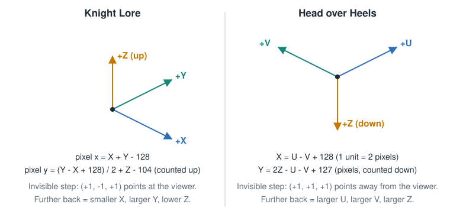

# Projection and coordinates

## The world is boxes

Both engines keep each object as an axis-aligned box in a small 3D space of 8-bit coordinates. Collision
and depth are worked out on those boxes. The sprite is only what gets drawn at the box's projected
position.

- Knight Lore: centre X and Y, base Z, half-sizes in X and Y, full height. The same box serves collision
  and depth
  ([DepthSort](https://jonsole.github.io/zx-spectrum-disassemblies/knightlore/DepthSort.html)).
- Head over Heels: U, V and Z coordinates plus a shape chosen by the low three flag bits, which gives the
  box's extents
  ([procobj.asm, `GetUVZExtents`](https://github.com/simon-frankau/head-over-heels/blob/master/src/objects/procobj.asm)).

## The two projections

| | Knight Lore | Head over Heels |
|---|---|---|
| Screen X | `X + Y - 128` pixels | `U - V + 128`, in units of 2 pixels |
| Screen Y | `(Y - X + 128)/2 + Z - 104`, counted **up** from the bottom | `2Z - U - V + 127` pixels, counted **down** |
| Z direction | up | **down**: an object's top is at a lower Z than its base |
| Further from the viewer | smaller X, larger Y, lower Z | larger U, larger V, larger Z |
| Step that does not move the picture | (+1, -1, +1) | (+1, +1, +1) |

Sources: Knight Lore from
[DepthSort](https://jonsole.github.io/zx-spectrum-disassemblies/knightlore/DepthSort.html); Head over
Heels from
[scene.asm, `UVZtoXY` and the extent notes](https://github.com/simon-frankau/head-over-heels/blob/master/src/gfx2/scene.asm).
The Head over Heels step and "further" row are *inference* from those formulas and from the extents in
`procobj.asm`, which take Z minus the height as the box's low Z. Both steps were checked numerically
(*simulation*).

Both are the 2:1 "dimetric" pixel projection that 8-bit isometric games use: a move along one floor axis
shifts the picture two pixels across for each pixel down or up. In Knight Lore one world unit is one pixel
across and half a pixel down. In Head over Heels it is two across and one down, and one Z unit is two
pixels up or down. *Inference* from the formulas.

## The invisible step

This is the idea everything else rests on. A projection from 3D to 2D loses one direction: moving along it
leaves the picture exactly where it was. That direction is the line of sight.

- It tells you what "in front" means: whichever box is met first when walking along that line from the
  viewer.
- It explains why depth can be decided from boxes alone, with no pixels involved.
- It gives a one-line test for "can these two ever overlap on screen", which is the subject of
  [02_DEPTH_SORTING.md](02_DEPTH_SORTING.md).

The same fact has a practical consequence for level design. An object at (X, Y, Z) and one at
(X+k, Y-k, Z+k) draw in the same place, so the player cannot tell them apart from position alone.
*Inference:* this is why shadows, stepped floors and clear reference objects matter in these games' rooms.
It is not stated by the sources.

## Choosing coordinates for a new engine

*Inference*, from comparing the two:

- Pick one convention where "further" means larger on every axis, as Head over Heels does. Depth tests are
  then the same comparison on all three axes, with no per-axis sign tables. Z pointing down is the price.
- Keep the projection cheap. Both games need only additions, one shift and a constant.
- Sub-pixel accuracy is a real cost choice. Head over Heels moves its pictures in 2-pixel steps across the
  screen, so it needs only a few pre-shift cases, as covered in
  [04_HEAD_OVER_HEELS_ENGINE.md](04_HEAD_OVER_HEELS_ENGINE.md). Layer 2 has no such problem, because every
  pixel is a byte.
- A cell grid for placing scenery (Knight Lore's is 8 by 8 cells at 16 units, with levels 12 units apart)
  keeps room data tiny and makes boxes line up, which reduces both cycles and visual glitches.

## General primers

- [Shaun Lebron, Drawing isometric boxes in the correct order](https://shaunlebron.github.io/IsometricBlocks/)
  flattens boxes to hexagons on three screen axes, a different and useful view of the same geometry.
- Juwal Bose's
  [moving platforms tutorial](https://code.tutsplus.com/isometric-depth-sorting-for-moving-platforms--cms-30226t)
  assumes the basics and refers to his primer on isometric worlds.
