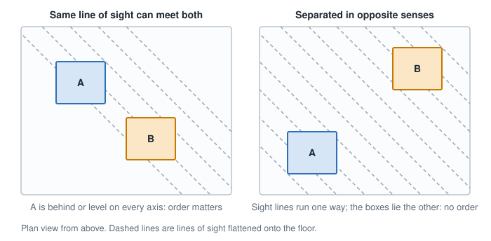
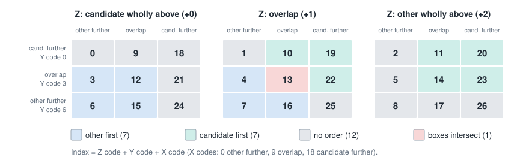
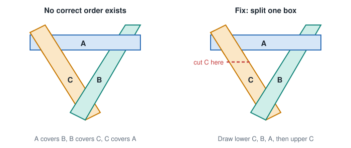

# Depth sorting

The goal is an order to paint in, so that each object is painted after everything it partly hides. This
is the painter's algorithm. The hard part is that "in front of" is not a simple sort key.

## Why a single depth value fails

*Inference:* boxes have size, so a single distance per box does not capture them. A long box can have a
centre further away than a small box that is really behind it. The relation is only defined for pairs that
can overlap on screen, and most pairs cannot. That makes it a **partial order**, and the correct tool in
theory is a topological sort
([Lebron's appendix](https://shaunlebron.github.io/IsometricBlocks/)).

## The pair test

For each axis, two boxes are in one of three states: A wholly further, overlapping, or B wholly further.
Knight Lore's rule from
[DepthSort](https://jonsole.github.io/zx-spectrum-disassemblies/knightlore/DepthSort.html):

- If A is behind or level with B on **every** axis, and behind on at least one, A must be drawn first.
- If the same holds the other way round, B must be drawn first.
- If each is behind the other on some axis, the order does not matter.
- If they overlap on all three axes, the boxes intersect and no order exists.

Exactly touching counts as apart, so objects can stand on each other and against each other.

### Why "no order" is safe

For one picture to cover the other, some line of sight has to pass through both boxes. Along a line of
sight, all three coordinates change in a fixed relationship. If the boxes are separated in opposite senses
on two axes, no line can satisfy both, so their pictures cannot overlap. The argument is the Jon Sole page's;
it applies to the boxes, so artwork spilling outside its box can still be wrong.

*Simulation:* on 200,000 random non-intersecting pairs, an exact line-of-sight test found 22,301 pairs where
one box really covered the other. The rule never said "no order" for any of them, and it chose the right
order for all of them. No pair covered in both directions.

### Knight Lore's table

The game encodes the three answers so they add up to a unique index from 0 to 26. A 27-entry jump table then
gives the outcome:

Source: the table as read out of the game on the
[DepthSort page](https://jonsole.github.io/zx-spectrum-disassemblies/knightlore/DepthSort.html). The counts
(7, 7, 12, 1) and the rule above were re-checked against every entry (*simulation*). The table is a speed
trick. The rule itself fits in a few comparisons.

### Head over Heels' comparison

[`DepthCmp`](https://github.com/simon-frankau/head-over-heels/blob/master/src/objects/depthcmp.asm) always
returns an order, plus a flag saying whether it is certain. Reading the code, it comes down to counting the
axes on which the boxes overlap:

| Axes overlapping | Compare | Certain? |
|---|---|---|
| Two | Low coordinate on the third axis | Yes |
| One | Sum of low coordinates on the other two axes | No |
| None | Sum of low coordinates on all three axes | No |

This summary is *inference* from reading the assembly; the file itself is only sparsely commented. Its branch
labels call the registers holding V "U" and the reverse, compared with `GetUVZExtents` in `procobj.asm`. The
logic is symmetric, so the labels are harmless, but it is confusing if you read the two files together.

*Simulation:* it also gave the correct answer on all 22,301 really occluding pairs above. Its limit is
elsewhere: a forced order on pairs that do not need one is not guaranteed to be consistent across a whole
list, as the next section shows.

## From pairs to a whole order

### 1. Knight Lore: search for something with nothing behind it

Each pass takes the first undrawn object as the candidate and compares it with the other undrawn objects. If
one must go first, that one becomes the candidate and the comparisons restart. A candidate that survives the
list is drawn, and the next pass begins
([DepthSort](https://jonsole.github.io/zx-spectrum-disassemblies/knightlore/DepthSort.html)). It needs no
stored sort state. Only objects flagged for redraw take part
([MovingObjects](https://jonsole.github.io/zx-spectrum-disassemblies/knightlore/MovingObjects.html)).

### 2. Head over Heels: a kept-sorted linked list

Objects sit in a doubly linked list ordered far to near. When one moves, it is unlinked and inserted again:
walk from the far end, remember the last object found to be further away, and stop early when `DepthCmp` gives
a certain answer that the new object is further
([procobj.asm, `DepthInsert`, `Relink`](https://github.com/simon-frankau/head-over-heels/blob/master/src/objects/procobj.asm)).
The list is always a total order, so there are no cycles to detect. Wrong pairs just stay wrong until
something moves. *Inference* from the code.

### 3. Topological sort

Build a graph with an edge from each box to the boxes behind it, then sort it. Only pairs whose screen shapes
overlap need an edge
([Lebron](https://shaunlebron.github.io/IsometricBlocks/),
[TextureMind](https://www.texturemind.com/post2354/)). TextureMind counts, for each box, how many boxes
it covers, and notes the check is N(N-1)/2 comparisons for N overlapping boxes. Plain counting does not handle cycles.

### 4. Static order with special cases

Tile-grid levels can draw row by row and floor by floor. Motion along one axis stays correct, motion along the
other breaks it, and Bose's fix splits the level into blocks ordered differently around the moving piece
([tutorial](https://code.tutsplus.com/isometric-depth-sorting-for-moving-platforms--cms-30226t)). It suits
small moving pieces on grids, and not Head over Heels style rooms with freely stacked objects.

## Cycles

Three or more boxes can each partly hide the next in a loop, so no order is right.

- **Knight Lore detects and accepts it.** It records every object made candidate since the last draw. When a
  switch would return to one of them, it draws that object at once, and one pair ends up wrong. The chain holds
  seven objects with no bounds check. Whether a real room can overflow it has not been measured
  ([DepthSort](https://jonsole.github.io/zx-spectrum-disassemblies/knightlore/DepthSort.html)).
- **Head over Heels never detects it.** See above.
- **Splitting** a box along a plane removes the cycle. Tarjan's strongly connected components algorithm can find
  the loops, or clipping regions can avoid the split
  ([Lebron](https://shaunlebron.github.io/IsometricBlocks/)). Head over Heels does split tall objects into
  two linked boxes
  ([procobj.asm, `AddObject`, `SyncDoubleObject`](https://github.com/simon-frankau/head-over-heels/blob/master/src/objects/procobj.asm)).
  *Inference:* small boxes on a cell grid make long overlapping shapes rare, so cycles rarely occur at all.

## How the two game methods compare

*Simulation:* random rooms in a 64 by 64 by 30 space, with boxes 6 to 8 units wide and 6 or 18 high, stacked on
6-unit levels, all boxes re-sorted from scratch, 3,000 scenes per row. "Wrong" counts pairs painted in an order
the exact test says is incorrect, including any forced by true cycles.

| Objects | Search: compares | Search: scenes with a wrong pair | Insertion: compares | Insertion: scenes with a wrong pair |
|---|---|---|---|---|
| 6 | 20 | 1 | 14 | 2 |
| 12 | 95 | 2 | 57 | 17 |
| 20 | 291 | 17 | 150 | 85 |
| 30 | 701 | 61 | 320 | 213 |

How to read this:

- Both are nearly always right at the object counts these games use. Knight Lore allows 40 records at most, and
  only those being redrawn take part.
- The search compares about twice as much and errs less. The insertion list errs more because it forces an order
  on pairs that have no true order, and those forced answers can conflict across a list.
- A moving object in a real game costs far less than this table's full sort: insertion re-places one object in a
  list that is otherwise already sorted.
- The model simplifies both games. It uses one list, not Head over Heels' five, ignores the games' sprite offsets
  and real room layouts, and has no cost model for the Z80.

*Inference:* a new engine should keep the box rule, limit comparisons to pairs whose screen rectangles overlap, and
keep rooms made of small boxes. Search or insertion can then be chosen on speed. On a 28 MHz Next either is cheap.
