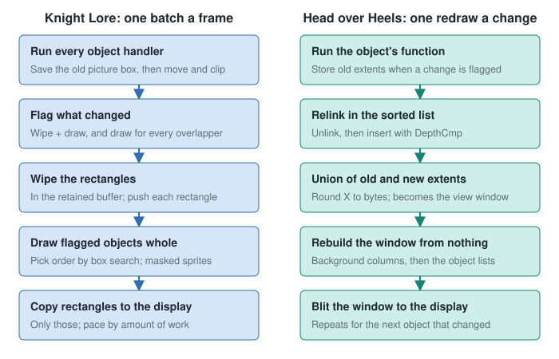
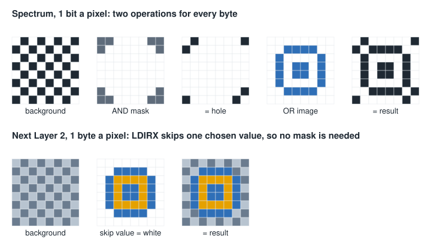

# Knight Lore: Filmation as built

Knight Lore (Ultimate, 1984) is the best documented of these engines. Unless noted, everything here comes from Jon
Sole's [SkoolKit disassembly](https://jonsole.github.io/zx-spectrum-disassemblies/knightlore/), which reassembles to
the snapshot on every build, and runs the game's own code to produce its examples
([Provenance](https://jonsole.github.io/zx-spectrum-disassemblies/knightlore/Provenance.html)).

## Memory

From [How the game is put together](https://jonsole.github.io/zx-spectrum-disassemblies/knightlore/Architecture.html):

| Range | Holds |
|---|---|
| `$5BA0-$5C07` | Game variables, with the stack just below |
| `$5C08-$6107` | Object table: 40 records of 32 bytes |
| `$6108-$D8F2` | Code and data, 30,699 bytes |
| `$D8F3-$F0F2` | Screen buffer that drawing composes into (6,144 bytes, exactly a bitmap) |
| `$F100` up | Lookup tables built at start-up |

The game never calls the ROM once running, so it can use the system variable area as ordinary memory.

## One object record

Fields documented across the
[DepthSort](https://jonsole.github.io/zx-spectrum-disassemblies/knightlore/DepthSort.html),
[MovingObjects](https://jonsole.github.io/zx-spectrum-disassemblies/knightlore/MovingObjects.html) and
[Collision](https://jonsole.github.io/zx-spectrum-disassemblies/knightlore/Collision.html) pages:

| Offset | Meaning |
|---|---|
| `+$00` | Type: selects both the handler and the sprite |
| `+$01`, `+$02`, `+$03` | Centre X, centre Y, base Z |
| `+$04`, `+$05`, `+$06` | Half-size X, half-size Y, full height |
| `+$07` | Flags, including bit 5 wipe, bit 4 draw, bit 2 can be pushed or carried, bit 1 skip in collisions, bit 0 walls off |
| `+$09`, `+$0A`, `+$0B` | Velocity dX, dY, dZ |
| `+$0C` | Bits saying which axis was blocked: bit 0 X, bit 1 Y, bit 2 Z (bit 2 means "standing on something"); top four bits count down the walk into a new room |
| `+$0D` | Harm and landing bits: 7 harms what it hits, 6 has been harmed, 5 harms what hits it, 3 something landed on it |
| `+$12`, `+$13` | Picture pixel offsets |
| `+$18` to `+$1B` | Picture width, height and pixel position |
| `+$1C` to `+$1F` | Copy of the above from before the handler ran |

An object animates by changing its own type: there is no frame number. That also changes its handler, so a type is
effectively a small state machine state
([Objects](https://jonsole.github.io/zx-spectrum-disassemblies/knightlore/Objects.html),
[Animations](https://jonsole.github.io/zx-spectrum-disassemblies/knightlore/Animations.html)). A person is two
records, legs and upper body, with the legs' handler in charge.

## The frame

From [How a moving object is drawn](https://jonsole.github.io/zx-spectrum-disassemblies/knightlore/MovingObjects.html):

1. **Every object gets a turn.** The main loop walks the 40 records and dispatches on type. It saves the old picture
   position first. The stack is reset before every object, so no handler can leave anything behind
   ([Architecture](https://jonsole.github.io/zx-spectrum-disassemblies/knightlore/Architecture.html)).
2. **Mark.** A changed object sets its wipe and draw flags, and takes the rectangle covering its old and new
   pictures. Every other object overlapping that rectangle gets the draw flag.
3. **Wipe.** Rectangles are cleared in the buffer, never on the display, and pushed on the stack.
4. **Draw.** Flagged objects are drawn whole, in the depth order from
   [02_DEPTH_SORTING.md](02_DEPTH_SORTING.md), each through its mask.
5. **Copy.** Only the rectangles go to the display. Nothing is erased on screen, so nothing flickers.
6. **Pace.** A frame's work (objects drawn plus rectangles copied) sets how long it waits. Light frames run evenly, and
   heavy ones slow down.

Entering a room skips the wipe: everything draws into a cleared buffer, and the whole buffer is copied once.

The worked example on the page: three changed objects in room `$01` give three rectangles, 32 by 20, 32 by 16 and 32 by
23 pixels, and **14 objects drawn** to fill them. Most redrawing is of things that did not move. Those pixels outside the
rectangles do not matter, because they are never copied.

## Masked sprites

All 103 sprites share one format: a header with width in bytes and height in rows, then a mask byte and an image byte per
cell, bottom row first. A sprite faces the other way by being **flipped in place**, and the header's top two bits
record which way the data currently lies
([Architecture](https://jonsole.github.io/zx-spectrum-disassemblies/knightlore/Architecture.html),
[Sprites](https://jonsole.github.io/zx-spectrum-disassemblies/knightlore/Sprites.html)).

The mask is what makes a black outline around white pixels possible on a 1-bit screen, and what lets objects overlap at all.
A whole room uses one ink colour on black
([RoomStructure](https://jonsole.github.io/zx-spectrum-disassemblies/knightlore/RoomStructure.html)), which avoids
attribute clash altogether.

## Collision

From [How collision works](https://jonsole.github.io/zx-spectrum-disassemblies/knightlore/Collision.html). The ideas
carry straight to any engine of this type:

- **Axes one at a time: Z, then X, then Y.** Each is tested against the room, then against every other object. Later axes
  see earlier moves already made.
- **Shorten a unit at a time** until the box fits. Because axes are separate, a diagonal walk into a wall slides along it.
- **Touching is not overlapping**, so objects can sit flush.
- **Gravity is one decrement of dZ.** There is no ceiling test.
- **Pushing** copies the mover's blocked velocity into the obstacle. The obstacle then moves when its own handler runs later
  in the same pass, and the mover still stops. What a push means is up to that handler.
- **Carrying**: a blocked Z move gives the mover the obstacle's dX and dY wherever its own are zero. Because Z is settled
  first, that velocity is tested normally in the same move.
- **Harm** passes through flag bits on any contact.

## Rooms in very little memory

From [Room structure](https://jonsole.github.io/zx-spectrum-disassemblies/knightlore/RoomStructure.html),
[Templates](https://jonsole.github.io/zx-spectrum-disassemblies/knightlore/Templates.html) and
[Scenery](https://jonsole.github.io/zx-spectrum-disassemblies/knightlore/Scenery.html):

- The castle is a 16 by 16 grid with 128 rooms. A room's number is row times 16 plus column, so leaving through a side is
  simple arithmetic.
- Room records are packed end to end with no index, and found by walking them.
- A record is: number, length, one byte for ink and size, background indexes, `$FF`, then object groups.
- An object group byte has a template index in its top five bits and a copy count in the low three, followed by one position
  byte per copy: x cell, y cell (8 by 8 grid) and level. Coordinates become `$48 + 16 * cell`, and `floor + 12 * level`.
- 29 templates and 24 backgrounds exist. A background carries its own fixed coordinates, so an arch is always in the same
  place. Walls and arches are ordinary object records, drawn and sorted with everything else.
- Three room sizes exist: 128 by 128 units, or narrow by half on one axis.
- A room becomes object records: the player's two, two for charms, then up to 36 others. Six rooms use all 36.

The older [On Filmation](https://web.archive.org/web/20230227014207/http://retrospec.sgn.net/users/nwalker/filmation/) site
(archive copy, frames) documents the same format across three games:

| Game | Rooms | Unique room blocks | Background items | Room data at |
|---|---|---|---|---|
| Knight Lore | 128 | 305 | 466 | `$6251` |
| Alien 8 | 128 | 573 | 547 | `$6469` |
| Pentagram | 139 | 284 | 565 | `$5E10` |

Pentagram's rooms and map may differ in detail: that site says only Knight Lore's and Alien 8's room numbers give the map
location directly.

Routine-level detail, with links into the listing, is in [06_KNIGHT_LORE_REFERENCE.md](06_KNIGHT_LORE_REFERENCE.md).

## What to take away

*Inference:*

- The design is small enough to hold in your head: 40 records, one depth rule, one sprite format.
- Keeping walls and arches as objects avoids special cases: the one sort handles them all.
- Drawing into a retained buffer, then copying rectangles, is why it looks solid despite running slowly.
- Its main costs are full-sprite draws for anything touching a change, and a search that restarts. Head over Heels attacks
  both, as [the next file](04_HEAD_OVER_HEELS_ENGINE.md) shows.
