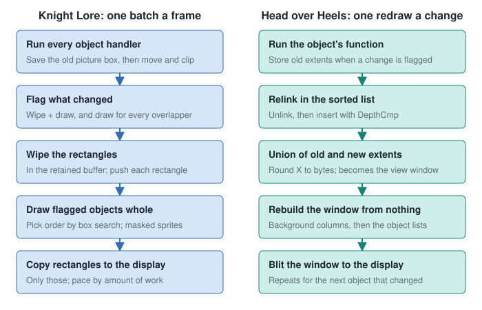
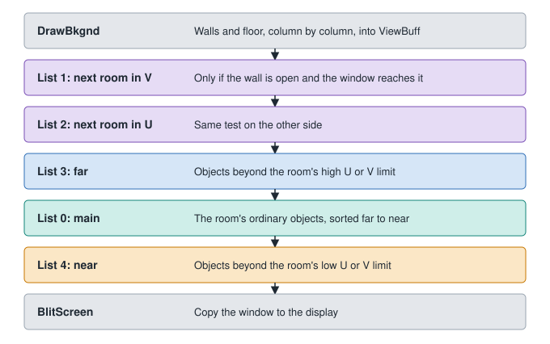

# Head over Heels: the engine as seen in the code

Head over Heels (Jon Ritman and Bernie Drummond, Ocean, 1987) is reported to reuse a modified version of the engine from
Ritman's Batman ([Wikipedia](https://en.wikipedia.org/wiki/Head_over_Heels_(video_game))). I found no disassembly of Batman, so
that link could not be checked.

The source here is [Simon Frankau's reverse engineering](https://github.com/simon-frankau/head-over-heels), which reassembles
to the original memory image. Its README warns that it is a personal, in-progress project, and some comments still say
"TODO" or "I believe". There is no prose explanation: **the descriptions below are this pack's reading of the code, so treat
them as *inference* unless marked otherwise.** File names are under its
[`src/`](https://github.com/simon-frankau/head-over-heels/tree/master/src) folder.

## Main loop

`mainloop.asm`: wait for the frame, read controls, run the special victory-room logic, run objects, check pause and character
swap, and play any queued sound. `DoObjects` (`objects/obj_fns.asm`) first updates the player's character, then walks the
main list. A phase bit flipped each pass stops an object running twice if moving re-links it further along the list.

## Object record

18 bytes (`objects/procobj.asm`, `objects/obj_fns.asm`, `objects/objects.asm`):

| Offset | Meaning |
|---|---|
| `+$00`, `+$02` | Links for the two directions of the doubly linked list |
| `+$04` | Flags, whose low three bits pick the box shape; bit 3 is "tall" |
| `+$05`, `+$06`, `+$07` | U, V, Z |
| `+$08` | Sprite code |
| `+$09` | Sprite flags, including bit 5 for a doubled object |
| `+$0A` | Object function, with its top bit used as the phase |
| `+$0B`, `+$0C` | Per-frame state, reset as functions run; exact meaning not fully resolved in the source |
| `+$0F` | Animation code |
| `+$10` | Direction |

### Box shapes

Instead of storing a size, the low three flag bits choose one of eight shapes, read from comments in `procobj.asm`. Values are
offsets from U, V and Z:

| Flags | U | V | Z | Use (*inference*) |
|---|---|---|---|---|
| 0 | +3, -3 | +3, -3 | 0, -6 | Standard object |
| 1 | +4, -4 | +4, -4 | 0, -6 | Slightly wider |
| 2 | +4, -4 | +1, -1 | 0, -6 | Thin along V |
| 3 | +1, -1 | +4, -4 | 0, -6 | Thin along U |
| 4 | +4, 0 | +4, 0 | 0, -18 | Tall post at one corner; door halves use shapes 4 to 7 (`DoorObjFlags` in `rooms/room.asm`) |
| 5 | 0, -4 | +4, 0 | 0, -18 | Same, other corner |
| 6 | +4, 0 | 0, -4 | 0, -18 | Same, other corner |
| 7 | 0, -4 | 0, -4 | 0, -18 | Same, other corner |

A tall object made of two pictures is two records linked in sequence, the second 6 Z units higher and kept in step by
`SyncDoubleObject`. Each half is inserted in the sorted list separately.

## Five sorted lists

`ObjectLists` holds five lists, each with heads for both directions:

| Index | List | Who goes there |
|---|---|---|
| 0 | Main | Ordinary objects in the room |
| 1 | Next room, V | Contents of the neighbouring room when the wall between is open |
| 2 | Next room, U | Same on the other side |
| 3 | Far | Objects beyond the room's high U or V limit |
| 4 | Near | Objects beyond the room's low U or V limit |

Separating these means whole groups never need comparing with each other. Their paint order is fixed, so a list only sorts
within itself. See [the depth sorting notes](02_DEPTH_SORTING.md#2-head-over-heels-a-kept-sorted-linked-list) for the
insertion.

## A redraw for each change

`objects/obj_fns.asm` and `gfx2/scene.asm`:

1. Before an object changes, `UpdateObjExtents` stores its old screen extents, once.
2. At the end of the object's function, `ObjDraw` re-links it in the list and calls `UnionAndDraw`.
3. The union of old and new extents becomes the view window, with X rounded out to whole bytes.
4. `DrawCore` rebuilds that window from nothing in the off-screen `ViewBuff`, then copies it to the display.

Each object is intersected with the window and blitted **clipped to it**, using a function picked by sprite width and overlap
size (`BlitMaskNofM`). `ViewBuff` is six bytes wide, so a window is at most 48 pixels across, and `BlitScreen` has a routine for
each width (`gfx1/blit_screen.asm`).

## Background without a stored picture

`gfx2/background.asm` keeps no room bitmap. A table, `BkgndData`, holds two bytes per pair of screen byte columns: the Y of the wall
bottom, and a wall panel id with a flip bit. Drawing a window column does the following from the top down: clear space above the
wall, copy the wall panel, then draw the floor pattern. Walls are 56 pixels high and the columns or blank spaces up to 74.

So the room is generated on demand, one window at a time. That saves about 6K of buffer at the cost of redoing work on each change.

## Sprites

From `gfx2/get_sprite.asm`, `gfx1/blit_mask.asm` and `gfx1/blit_rot.asm`:

- Sizes by code: 3 by 56 bytes-by-rows for doors, 3 by 24 or 3 by 32 for most things, 4 by 28 for the largest, so widths are 24 or
  32 pixels.
- Screen X is in 2-pixel units, so a picture can sit at four alignments within a byte. `BlitRot` shifts a copy into a work buffer for
  the three non-aligned cases, which adds a byte of width.
- Flipping uses a bit-reverse table, `InitRevTbl`.
- A masked blit does an AND with the mask and an OR with the image per byte, the same as in
  [Knight Lore](03_KNIGHT_LORE_ENGINE.md#masked-sprites).

## Patching what the sort cannot do

`gfx2/occlude.asm` copies a door sprite and cuts a wedge off its edge, widening row by row, because a wall panel should hide part of it.
The door's raised height changes where the cut starts. This matters for the Next design: the scenery that hides things
**is not always an object**, and walls are not in the sort. Real engines patch cases like this by hand.

## Room data

`rooms/room.asm` decodes bit-packed data. The
[CPC disassembly's `scripts/hoh_rooms.py`](https://github.com/fphenix/headoverheels_cpc/blob/master/scripts/hoh_rooms.py) is the
clearest statement of the format, for the CPC version, which its README says is very similar:

| Bits | Field |
|---|---|
| 3 | Room dimensions: an index into eight `RoomShapes` of min and max U and V |
| 3 | Colour scheme |
| 3 | World |
| 3 | Door sprite |
| 4 x 3 | Door state for each wall: wall, no wall, or a door at a height |
| 3 | Floor type |
| then | Entries until the end code |

An entry is an 8-bit id:

- Below `$C0`: an object, with 2 flag bits, then flip bits (one shared, or one per copy, depending on those flags), then one or more 3-bit U, V, Z triples. Triple 7, 7, 0 ends a loop.
- `$C0` and up: a **macro**, a reusable group placed at an offset. Macros can nest, using a small stack of origins (`DecodeOrgStack`).
- `$FF`: end of the room or macro.

Room ids are three hex digits read as row, column and height in the script, so the castle is a real 3D grid. Rooms remember their state
(`BuildRoomNoObj`, `SkipObj`).

## How it differs from Knight Lore

| | Knight Lore | Head over Heels |
|---|---|---|
| Order | Search among flagged objects, every frame | Sorted list, updated when something moves |
| Redraw unit | One batch per frame | One window per moving object |
| Drawing | Whole sprites into a retained buffer | Sprites clipped to the window, in a window-sized buffer |
| Clearing | Wipe rectangles | Regenerate background for the window |
| Walls and floor | Objects in the sort | Procedural background, with a hand-made fix for doors |
| Cycles | Detected and broken | Not detected |
| Depth test | Three-way per axis, table | Count overlapping axes, always answer |
| Room data | Byte-packed, templates | Bit-packed, recursive macros |
| Screen X and flipping | Units of 1 pixel; sprite data flipped in place | Units of 2 pixels; shifted into a buffer, flipped via a table |

Sources as above. The table is this pack's comparison.

*Inference:* Knight Lore's design is simpler to reason about, while Head over Heels spends more code to avoid drawing whole sprites. When
several objects overlap, each one's window can redraw the same pixels. Its approach suits a game with a few moving objects in each room.

## What was not read

The behaviour functions (`objects/obj_fns.asm` beyond those named), `character.asm`, `movement.asm`, `contact.asm`, and the detail of
`background.asm` were skimmed or only searched. Fred Limouzin's main file, `Disasm/fileinfo_II.txt` in the
[CPC project](https://github.com/fphenix/headoverheels_cpc), was not read, and may answer the unresolved field meanings.
