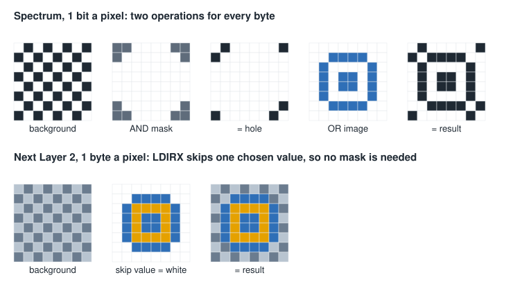
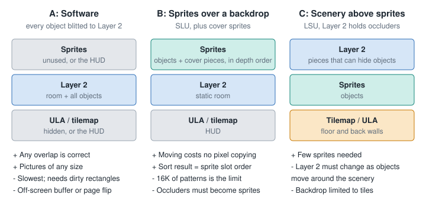

# What changes on the ZX Spectrum Next

Nothing in this file has been run on a Next or in an emulator. The hardware facts are cited. The designs and budgets are
*inference*, meant to be tested with a prototype.

## Hardware facts that matter

| Fact | Source |
|---|---|
| 128 sprites of 16 by 16, with 2x, 4x and 8x scaling, mirroring and rotation | [SpecNext Wiki: Sprites](https://wiki.specnext.dev/Sprites) |
| 16K of pattern memory: 64 8-bit patterns (256 bytes), 128 4-bit patterns (128 bytes), or a mix | [Wiki](https://wiki.specnext.dev/Sprites), [Klive: Sprites](../../../docs/content/en/under-the-hood/emulator-internals/next-display/sprites.mdx) |
| Anchor plus relative sprites: moving the anchor moves its group; relatives hold offsets | [Wiki](https://wiki.specnext.dev/Sprites) |
| Drawn in slot order 0 to 127; NextReg `$15` bit 6 picks which end is on top | [Wiki](https://wiki.specnext.dev/Sprites), [Klive: Sprites](../../../docs/content/en/under-the-hood/emulator-internals/next-display/sprites.mdx) |
| Sprite budget: 1,824 clocks a line in 128K timing; a 1x sprite on the line costs 17, and 75 fit when all are on the line | [Klive: Sprites](../../../docs/content/en/under-the-hood/emulator-internals/next-display/sprites.mdx) |
| Layer 2: 256 by 192 or 320 by 256 at 8 bits, or 640 by 256 at 4 bits; 48K or 80K | [SpecNext Wiki: Layer 2](https://wiki.specnext.dev/Layer_2) |
| Layer 2 active and shadow pictures, NextRegs `$12` and `$13` | [Klive: Layer 2](../../../docs/content/en/under-the-hood/emulator-internals/next-display/layer2.mdx) |
| Six layer orders in NextReg `$15` bits 4-2, which can change mid-screen | [Klive: Composition](../../../docs/content/en/under-the-hood/emulator-internals/next-display/composition.mdx) |
| A Layer 2 **palette entry** can carry a priority bit that lifts its pixels above all layers | [Klive: Composition](../../../docs/content/en/under-the-hood/emulator-internals/next-display/composition.mdx) |
| Tilemap can also sit above or below the ULA, per tile | [Klive: Tilemap](../../../docs/content/en/under-the-hood/emulator-internals/next-display/tilemap.mdx) |
| `LDIRX` copies a block but skips bytes equal to A; 21 T-states a byte while repeating | [Developer guide](../zx-next-dev-guide-r3.pdf), instruction chapter |
| `LDWS` copies a byte, then increments L and D: for vertical copies to Layer 2 | [Developer guide](../zx-next-dev-guide-r3.pdf) |
| zxnDMA runs at CPU speed on current cores | [Developer guide](../zx-next-dev-guide-r3.pdf), section 3.3.11 |

The wiki says at least 100 sprites a line, and the Klive article says 75 when every sprite is on the line and explains the
cut-off rule behind it. Plan for the lower number until it is measured.

## A time budget

*Inference.* At 28 MHz and 50 Hz, a frame is about 560,000 T-states. These figures ignore wait states, interrupts and loop
overhead, so real results will be worse:

| Job | Size | Cost | Share of a frame |
|---|---|---|---|
| Full-screen Layer 2 copy with `LDIR` or `LDIRX` | 49,152 bytes | about 1,032,000 T | **184%**: not possible |
| Skip-value copy of a 32 by 32 sprite | 1,024 bytes | about 21,500 T | 3.8% |
| Restore a 64 by 64 dirty rectangle, a row at a time | 4,096 bytes | about 86,000 T | 15% |
| Compare 30 objects, 700 pair tests at about 200 T each | | about 140,000 T | 25%, if done every frame and unoptimized |
| Write 5 attribute bytes for 128 sprites with `OTIR` | 640 bytes | about 13,400 T | 2.4% |

Conclusions:

- **Dirty rectangles are still required** for software drawing, even at 28 MHz.
- **Sorting is not free, but is manageable.** Keep the Head over Heels trick: re-insert only what moved, or test only
  overlapping screen rectangles. The 200 T figure is a guess to be replaced by measurement.
- **Hardware sprites save far more than they cost.**

## Masking disappears

Layer 2 is a byte per pixel with a chosen transparent value, and `LDIRX` skips one chosen value. So each sprite row is one
block copy with no separate mask, with memory and code both simpler than on the Spectrum. Note that it skips only one exact byte
value. No sub-pixel shifting is needed either, because any X is byte-aligned.

Rows are consecutive in memory in 256 by 192, with a line every 256 bytes, so the high byte of an address is the row. The wide
modes store columns consecutively instead, so a block copy runs down the screen
([Layer 2 wiki](https://wiki.specnext.dev/Layer_2),
[Klive: Layer 2](../../../docs/content/en/under-the-hood/emulator-internals/next-display/layer2.mdx)). *Inference:* each
sprite row is one `LDIRX` plus a little code to move to the next row, which the budget below leaves out. A sprite can also cross an
8K page, so the drawing loop must handle paging.

## Three architectures

### A: All software, in Layer 2

Knight Lore's frame, with 8-bit pixels: a clean copy of the room in spare banks, dirty rectangles, objects copied with `LDIRX` in
sorted order, then the rectangle copied to the visible picture.

- Simple, and always correct, because painting order decides everything.
- The time budget limits it, as moving many large objects multiplies the redrawn area.
- Tearing is a concern unless copies happen away from the beam or a shadow picture is used. With page flipping, both pictures
  need each rectangle, so that doubles part of the cost.

This is the lowest-risk first version and also the fallback for the options below.

### B: Sprites over a static room

The room is painted once into Layer 2. Moving objects are hardware sprites, in slot order from the sort.

The hard part is a moving object passing **behind** something in the Layer 2 picture, since a sprite is either above or below the whole
layer. Ways to solve this:

1. **Cover sprites.** When a moving sprite's rectangle overlaps a nearer static object, show that static object's picture as extra
   sprites, sorted with the rest. Only the covering pieces are needed, and only while the overlap lasts. Cost: pattern memory.
2. **Make all scenery sprites.** No special cases, but 128 sprites of 16 by 16 only cover so much. A 32 by 32 object needs four.
3. **Layer 2 priority colours.** Scenery that is **always** in front (a near arch, a foreground rail) can use priority colours. This
   fails where an object can go on either side, because the priority belongs to the colour and not to the object's depth.
4. **Restrict the rooms.** Design rooms so the back walls and floor are all that Layer 2 holds, and everything standing is a sprite.

Pattern memory is the main limit. At 4 bits a pixel, 128 patterns is 32 frames of 32 by 32 pictures. Options: load a room's set on entry,
or stream animation frames as they are needed, at 128 bytes a pattern. A palette offset per sprite gives cheap colour variety. Knight Lore's
rooms name only a few templates each, so a per-room set looks plausible.

Group handling: relative sprites follow their anchor in the table, so re-sorting moves a whole group's slots. Writing attributes fresh each
frame in sorted order is the simplest way and is cheap by the table above. Depth comparisons between pieces of the same object are
not needed, because each object sorts as one unit.

### C: Layer 2 above sprites

Sprites go behind Layer 2, in order LSU, with the floor and back walls in the tilemap or ULA. Layer 2 holds only what can hide objects, and is
transparent elsewhere.

This inverts the problem and has the same fault in reverse: an object standing **in front** of a Layer 2 piece is hidden wrongly, unless that
piece is cleared from Layer 2 while the object is there. So software drawing returns, though for fewer pixels. Tile backdrops also lose some
freedom, because tiles are 8 by 8 cells. It looks less attractive than B, but deserves a test if tile art suits the game.

### Which to try

*Inference:* start with **A** in 256 by 192, because it validates the world, the sort and collision with the fewest hardware unknowns.
Then move moving objects to sprites, **B**, using cover sprites for occlusion. The sort, the world and the data format are shared.

## A prototype order

1. Run the world logic off-target or in a small test: box records, the pair rule, collision by axis.
2. Draw one static room to Layer 2 in sorted order. The projection, sort and data format get proved here.
3. Add one moving object with dirty rectangles. Measure T-states against the budget above.
4. Add stacking, pushing and carrying.
5. Move the object to hardware sprites, and add cover sprites for scenery in front.
6. Add the room format, then the doors and scrolling between rooms.
7. Stress: the most objects expected on one screen line, the largest dirty area, and the worst room for cycles.

## Open questions

- **Measured sort cost.** How many T-states does a pair test take in real Z80N code? Is `MUL D,E` or a table of any use here?
- **DMA.** How much does the zxnDMA save on rectangle rows? The Klive
  [DMA article](../../../docs/content/en/under-the-hood/emulator-internals/next-dma.mdx) and the
  [local DMA samples](../dma-samples.md) are the place to start. It cannot skip a transparent value as far as was checked here, so it fits
  restoring backgrounds rather than drawing objects.
- **Screen mode.** 320 by 256 gives more room, but 80K per picture and column order. Is the extra space worth it?
- **Frame rate.** Do rooms need 50 Hz, or would a steady 25 Hz leave time for much richer art? Knight Lore's own pacing lets busy frames slow
  down.
- **Layer 2 priority on the wide modes and with blending.** Not looked into beyond the cited section.
- **Palette use across rooms** and whether a per-room palette change is visible on transitions.
- **Art resolution.** A 256-colour pixel-art object at 32 by 32 is a different job from a 1-bit one, and may be the biggest cost of the project.

## No prior Next engine found

Searches on 2026-11-06 found no write-up of an isometric engine for the Next. That does not prove none exists: forums and the
Next's own community channels were not searched in depth, and a question there would be worth asking.
